# Vysta — redesign inspiration (appllama-informed)

Inspiration only. No app code changed.

**How these were made.** The Appllama MCP is a library of real top-grossing iOS
app screens (search + browse), not an image generator. I used it to pull
reference patterns (6 credits), then built each mockup as HTML/CSS in
[`appllama/src/`](appllama/src/) and rendered it with headless Chrome
(`bash docs/design/appllama/src/render.sh [name…]`). Phone screens are 390×844
@2x and the share card is 1080×1920. The cathedral photo is a stylised SVG
stand-in (`src/scene.svg`). Emoji avatars stand in for the real `Figurines`
component, and Segoe UI stands in for SF Pro on Windows.

**References pulled from Appllama**
- *Pinterest, Visual Search Results.* "Ask anything" pill at the top, suggestion chips floating above a peeking results sheet. → answer v2.
- *Polycam, capture.* Hint toast directly above the shutter, vertical control rail on the right, mode text row under the shutter. → dock v2/v3.
- *SHEIN, Visual Search.* Album sheet that peeks up from below the camera. → gallery entry points.

**Shared style used everywhere.** Base `#05070a`; glass = white 8–14 % vertical gradient + `blur(20px) saturate(160%)`; 1px hairlines `rgba(255,255,255,.10–.14)`; inner top highlight + 3-layer soft shadow; radii 16–34px; gold pin `#ffd166`; accent used only for the title, the primary action and the highlight glow.

> ⚠️ Accent contrast: historian `#8e1b1b` (and child `#d62828` to a lesser degree) is unreadable as **text** on near-black. The mocks use a lifted text tint per persona (`--accent-text`: `#ff5a5a` / `#ff7a45` / `#e0806a`) and keep the raw accent for fills. Do this whatever variant you pick.

---

## 1. Answer screen

| v1 | v2 | v3 |
|---|---|---|
| 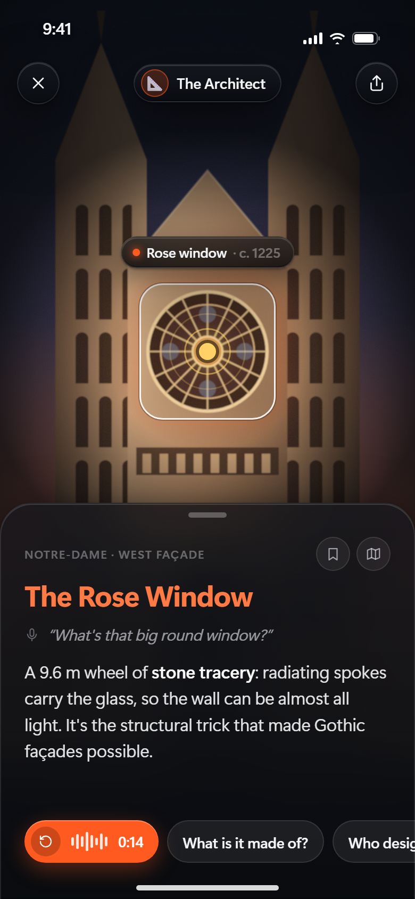 | 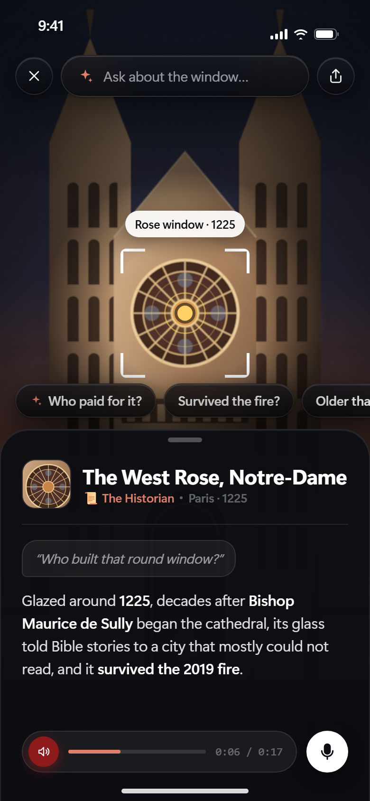 | 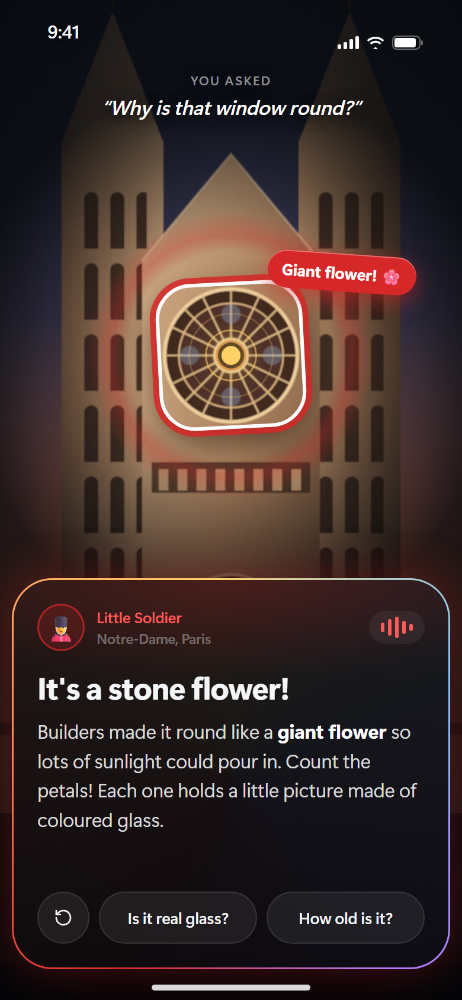 |
| Architect | Historian | Little Soldier |

- **v1 — Spotlight + classic sheet.** Radial spotlight dims everything outside the target. The highlight is a rounded box with an accent glow, the gold pin pulses with two rings, and a glass label chip ("Rose window · c. 1225") sits above it. The full-width glass sheet shows the place, the title in accent, the transcript in italics, then the answer. A filled accent replay pill with a waveform sits in a single row with the follow-up chips. *Strong:* closest to the current build, clear hierarchy, one obvious primary action.
- **v2 — Lens-style.** Corner brackets replace the box, and a mask-based dim gives a softer falloff. An "Ask about the window…" pill sits at the top and follow-up chips float *above* the sheet, as in Pinterest. The sheet header has a cropped thumbnail, the title in white, and persona + place as metadata. The question is shown as a chat bubble. A progress bar for the audio sits next to a white mic for asking a follow-up. *Strong:* reads instantly as "visual search result", and follow-ups stay visible even when the sheet is collapsed. *Weak:* the persona has the least presence here.
- **v3 — Floating card + Siri glow.** A detached card is inset 10px with a persona-gradient conic rim and glow. The transcript appears as a caption at the top ("You asked…"). The highlight is a persona-styled box (child = tilted sticker frame with a sticker label), with a soft accent halo behind the pin and a live waveform badge while speaking. *Strong:* the most "AI moment" feel and the most persona character. *Weak:* the glow rim is loud next to three accent colours, and the card covers more of the photo.

**Ranking: v1 > v3 > v2.** v1 is the safest upgrade with the most polish per line of CSS. Most of it is the spotlight, label chip and replay pill, which slot into the current `Overlay`/`AnswerCard`. Then borrow two things from v3: the persona-styled highlight frame (sticker/drafting/ink already exists as `frame`) and the live waveform badge. v2's chips-above-sheet is worth stealing later, once the sheet can be dragged to a peek state.

## 2. Live camera + dock

| v1 | v2 | v3 |
|---|---|---|
| 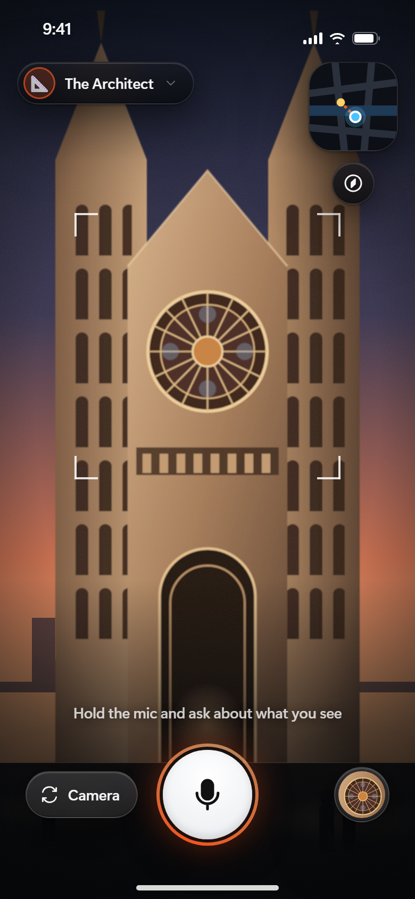 | 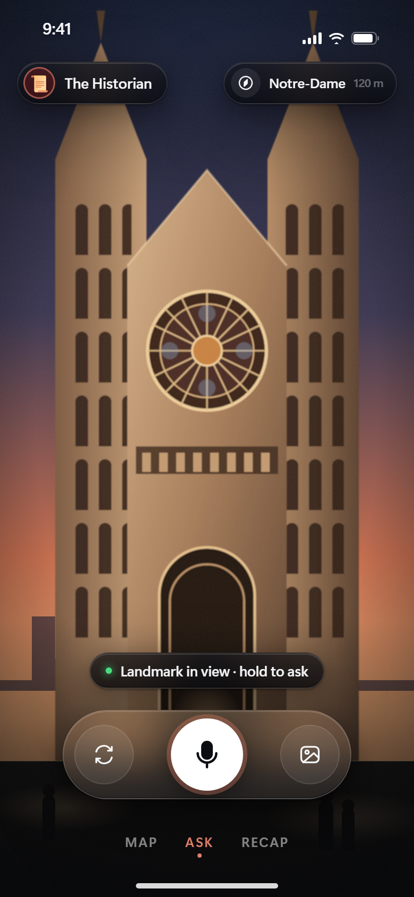 | 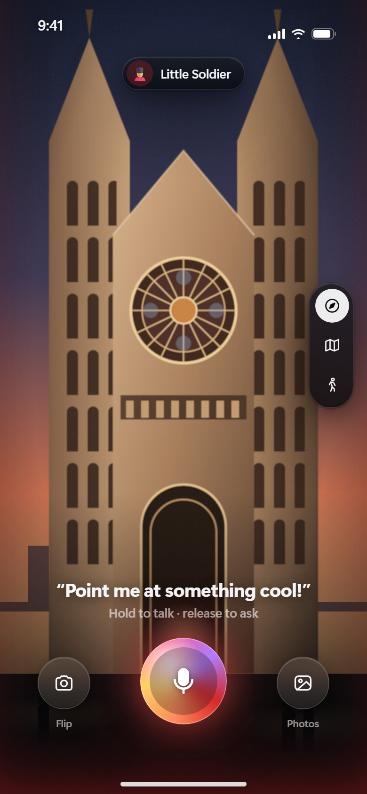 |

- **v1 — Refined current.** No dock bar, just a bottom scrim. A white 84px mic sits inside a conic accent ring. The Camera pill (left) and the gallery circle (right) are glass, and the gallery circle shows the last photo as a thumbnail. Top left: a persona switcher pill with a chevron. Top right: a minimap tile with the compass under it. Thin reticle corners. *Strong:* minimal change from today, with clear depth.
- **v2 — Floating capsule (visionOS).** A single glass capsule holds flip · mic · gallery. Below it, a text mode row (MAP · **ASK** · RECAP) borrowed from Polycam. Top right merges compass and minimap into one "Notre-Dame · 120 m" widget. A green-dot toast says "Landmark in view · hold to ask". *Strong:* the tidiest; the mode row makes the map and recap discoverable. *Weak:* the capsule shrinks the mic target to 68px.
- **v3 — Siri orb.** The mic is a glowing conic orb in the persona gradient. The persona's greeting is the hint ("Point me at something cool!"), and labelled Flip/Photos buttons sit either side. A Polycam-style right rail holds compass / map / walk, and an accent edge glow runs along the bottom. *Strong:* the most delightful, and the voice-first intent is obvious. *Weak:* the orb gradient competes with the persona accents, and the rail adds chrome.

**Ranking: v1 > v2 > v3.** v1 keeps the big thumb target and needs no new navigation. Take v2's "landmark in view" toast (good feedback that grounding works) and consider its mode row if the map or recap get lost. Keep v3's orb as the **listening** state rather than the idle state.

## 3. Onboarding / guide picker

| v1 | v2 | v3 |
|---|---|---|
| 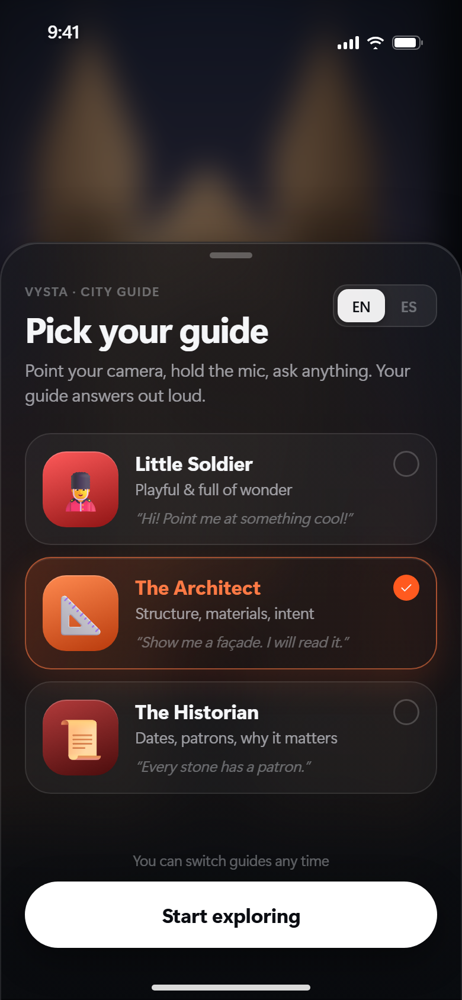 | 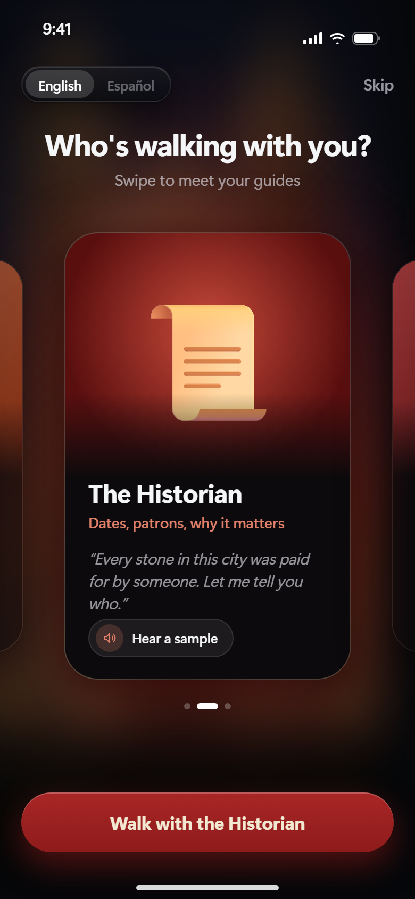 | 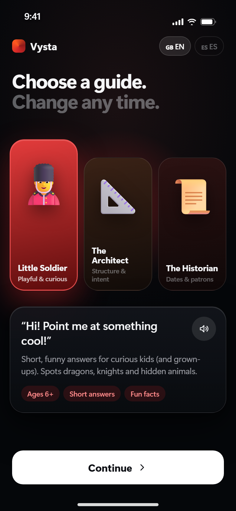 |

- **v1 — Stacked list sheet.** Glass sheet over the blurred camera feed, with an EN/ES segmented control in the header. Three rows: gradient avatar tile, name, tagline and the persona's own greeting. The selected row gets an accent wash, an accent rim and a check. White "Start exploring" CTA. *Strong:* everything is comparable at a glance, and it fits the existing `GuideSheet` layout.
- **v2 — Character carousel.** Full-screen hero card per persona, with the neighbours peeking in at the sides, page dots, and a "Hear a sample" voice preview. The CTA is tinted in the persona colour ("Walk with the Historian"). *Strong:* the most emotional and the best showcase for the figurines and voices. *Weak:* you can only see one guide at a time, and it needs swipe UI.
- **v3 — Figurine tiles + detail panel.** Three tall tiles in a row; the selected one lifts and glows. Below, a panel shows the greeting, a description, tags (Ages 6+, Short answers) and a play button. Language is a pill toggle at the top right. *Strong:* side by side **and** rich detail; feels like a product. *Weak:* tile names get tight at 390px ("The Architect" wraps).

**Ranking: v3 > v1 > v2.** v3 lets people compare and also gives each guide room to "audition" (greeting + voice sample). v1 is the fastest fallback. v2 is the demo crowd-pleaser if you want a cinematic first launch.

## 4. Bonus — share card + recap

| Share card (1080×1920) | Recap |
|---|---|
| 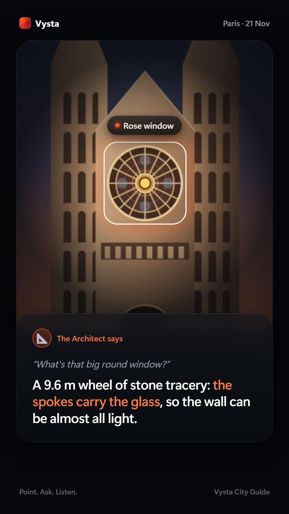 | 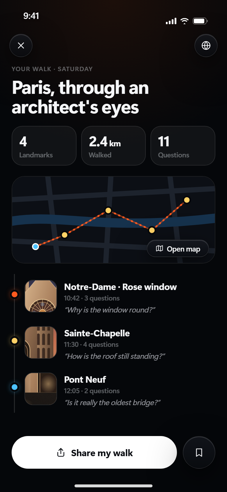 |

- **Share card.** Story format: the frozen frame with the same spotlight, highlight and label as in-app, then a glass quote card ("The Architect says", the question, a big answer with the key phrase in accent). The brand sits at top and bottom. It reuses the answer-screen visuals, so a share is recognisable as Vysta.
- **Recap.** Title in the persona's voice ("Paris, through an architect's eyes"), three stat tiles, a route map with a gold stop for each landmark, then a timeline of stops (thumbnail, time, number of questions, best question). Primary "Share my walk" button plus save.

Both are single-variant explorations. Recommended as-is as the starting point.

---

## Before / after

The current build in mock mode (`VITE_MOCK_API=true`), captured by
[`src/capture-before.mjs`](appllama/src/capture-before.mjs). It uses headless
Chrome, with the same cathedral scene fed in as a fake camera, so both sides
show the same view. Raw captures are in [`appllama/before/`](appllama/before/).
The "before" answer text is the mock's London-dragon copy, which is why its
words don't match the cathedral.

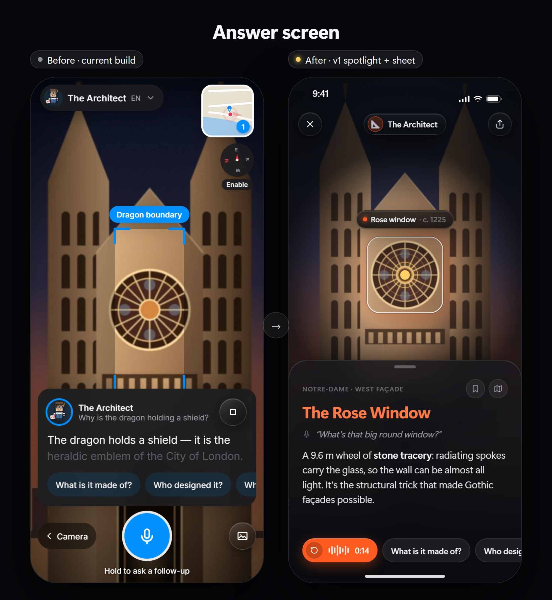
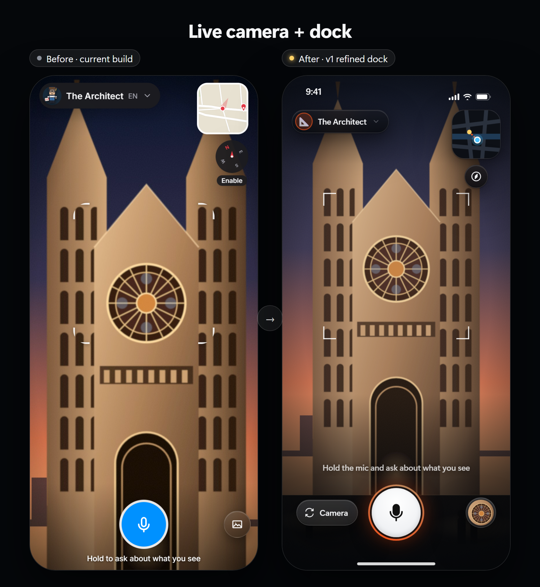
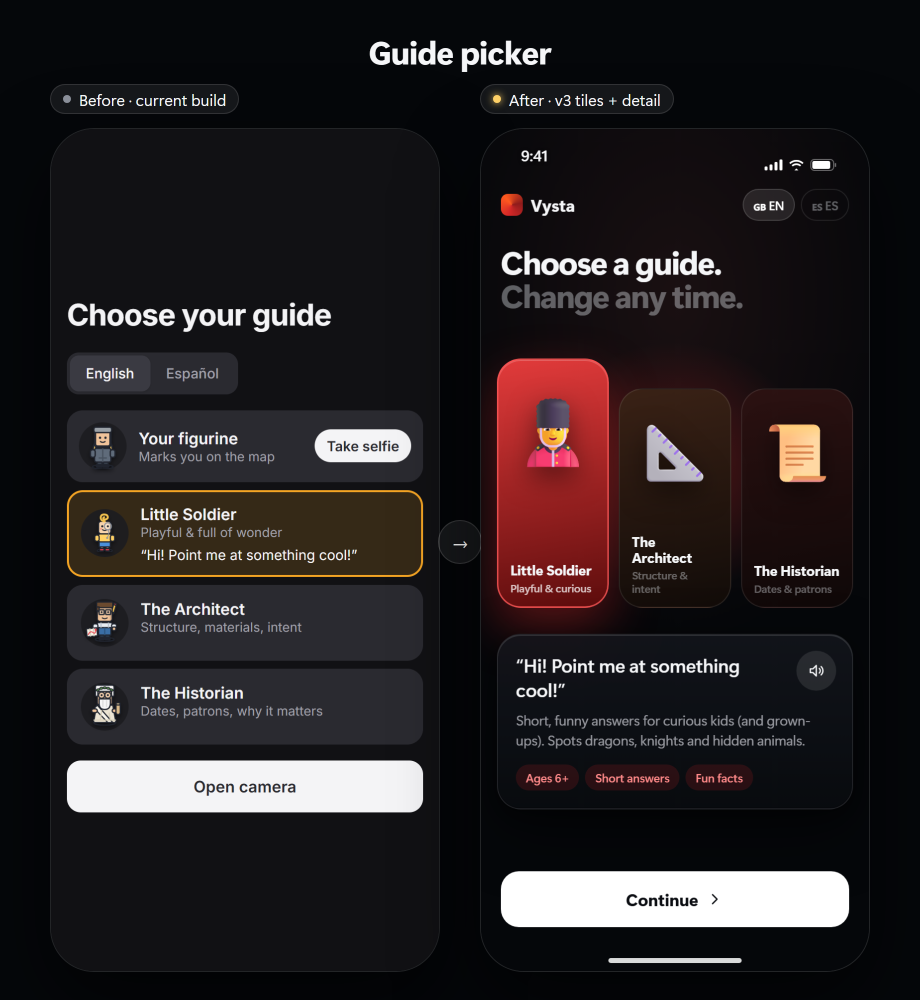

What the comparison shows:
- **Answer.** Today the answer card covers the bottom of the highlight, and nothing dims the rest of the frame. In the redesign the spotlight and the taller sheet keep the target clear. The landmark title, the replay control and the persona accent all become easier to see. **Gap in the mock:** it drops the hold-to-ask mic in the answer state. An implementation must keep a mic (as v2 does, beside the replay bar).
- **Dock.** The structure stays the same. What changes is depth: a glass Camera pill, a gallery button that shows the last photo, a softer mic ring, the minimap restyled for dark mode, and a bottom scrim so the hint text stays legible on bright scenes.
- **Guide picker.** The current list (which includes the selfie "Your figurine" row) becomes side-by-side tiles plus a detail panel. **Keep the selfie row**: the mock leaves it out, and the real pixel-art figurines should replace the emoji.

### Every variant against the current build

| Screen | Alternatives |
|---|---|
| Answer | [v2 Lens-style](appllama/compare-answer-v2.png) · [v3 floating card](appllama/compare-answer-v3.png) |
| Dock | [v2 glass capsule](appllama/compare-dock-v2.png) · [v3 Siri orb](appllama/compare-dock-v3.png) |
| Guide picker | [v1 stacked list](appllama/compare-onboarding-v1.png) · [v2 carousel](appllama/compare-onboarding-v2.png) |

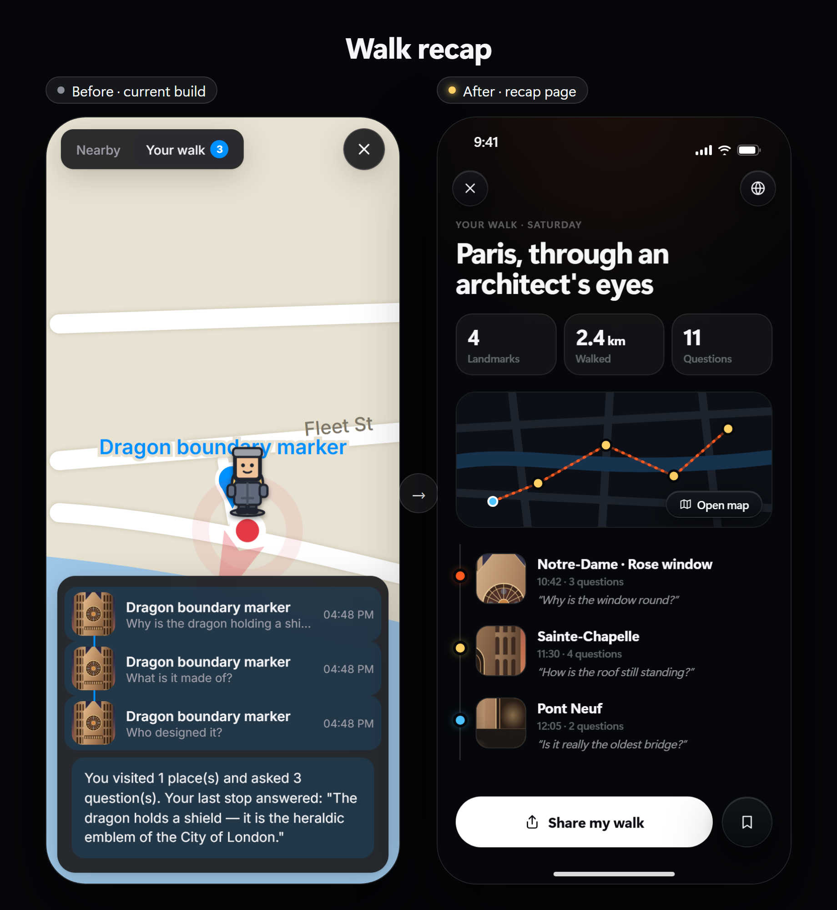

- **Recap.** Today the recap is a paragraph of text at the bottom of the map sheet's "Your walk" tab, under a list of stops. In mock mode every question counts as its own stop, so the same landmark appears three times. The redesign makes it a dark-themed page of its own: a title in the guide's voice, stat tiles, a route map, a timeline that **groups questions per landmark**, and a "Share my walk" button. The map sheet is also the only light-themed screen in the current app.

Also captured with no redesign to compare against yet: [`before/listening.png`](appllama/before/listening.png) and [`before/map.png`](appllama/before/map.png).

> **Colour note:** in the running app the Architect's accent is **blue** (`styles.css` sets `#0091ff` per `[data-persona]`), while `personas.ts` says `#ff5a1f`. The mocks follow the brief (orange). Decide which source of truth wins before implementing.

---

## Recommendations at a glance

| Screen | Pick | Borrow from |
|---|---|---|
| Answer | **v1** spotlight + sheet | v3 persona highlight frame + waveform badge; v2 chips-above-sheet later |
| Live dock | **v1** refined | v2 "landmark in view" toast; v3 orb as the *listening* state |
| Onboarding | **v3** tiles + detail | v1 if time is short |
| Share / recap | v1 of each | — |
| Global | Lifted `--accent-text` per persona for text on dark | — |
